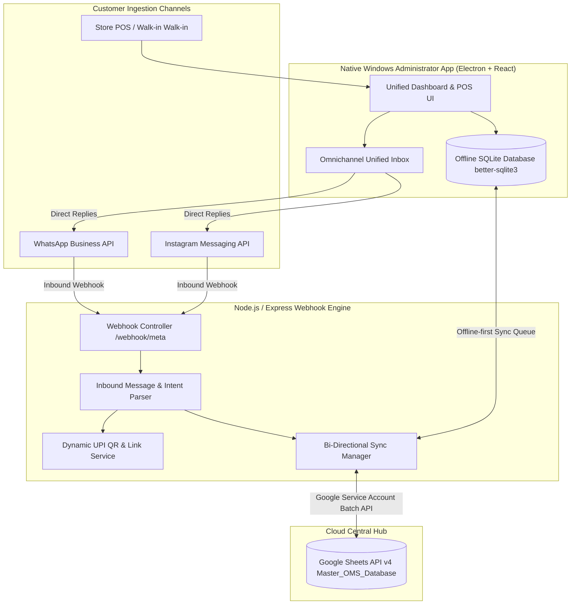

# System Architecture & Implementation Plan: "The Laddu Story" OMS
## Enterprise Omnichannel Order Management System (Zero-Cost Tier)

---

### 1. Executive Summary & Core Mission
**The Laddu Story** is a high-velocity artisanal sweet brand requiring an omnichannel retail and delivery operational system. The system eliminates manual order consolidation, prevents stockouts/overselling, and bridges physical walk-in sales with social commerce (WhatsApp Business & Instagram DM).

#### Key Pillars:
1. **Zero-Cost Infrastructure:** Powered by Google Sheets API v4 (acting as the cloud ledger), local SQLite (offline persistence), and Meta Cloud API (free tier up to 1,000 conversations/month).
2. **True Omnichannel Sync:** Real-time bi-directional synchronization between Walk-in POS, WhatsApp orders, Instagram DMs, and central inventory.
3. **Offline-First Windows Admin Terminal:** Desktop app that allows continuous store POS operations during network outages, syncing changes to Google Sheets when reconnected.
4. **Automated UPI Payment Workflows:** Instant dynamic UPI QR generation (`upi://pay`) and payment confirmation logging.

---

### 2. High-Level System Architecture



---

### 3. Target Directory & Monorepo Structure

The project will reside in a dedicated root directory `the-laddu-story/` to preserve clean separation from existing repositories:

```
the-laddu-story/
├── .env.example                     # Unified environment template
├── .gitignore                       # Node, Electron, SQLite, & Key ignores
├── package.json                     # Monorepo root workspace configuration
│
├── schema/                          # TypeScript Canonical Data Contracts
│   ├── index.ts                     # Barrel exports
│   ├── order.types.ts               # Order, Item, Status, Channel enums
│   ├── inventory.types.ts           # SKU, Stock, Reorder thresholds
│   ├── customer.types.ts            # Customer CRM profiles & LTV
│   ├── webhook.types.ts             # Meta Webhook payload definitions
│   └── sync.types.ts                # Audit logs & sync queue events
│
├── scripts/                         # DevOps & Setup Automation
│   ├── google-sheets-setup.js       # Auto-provisions spreadsheet with formulas
│   └── seed-data.js                 # Initial inventory & test customers
│
├── server/                          # Backend Middleware & Webhook Hub
│   ├── src/
│   │   ├── index.js                 # Express server bootstrap & port listener
│   │   ├── routes/
│   │   │   ├── webhookRoutes.js     # GET/POST /webhook/meta endpoints
│   │   │   ├── orderRoutes.js       # Ingestion & status change APIs
│   │   │   └── inventoryRoutes.js   # Stock adjustment & lookup APIs
│   │   ├── services/
│   │   │   ├── metaWebhookService.js# Parser for WhatsApp & IG DMs
│   │   │   ├── googleSheetsService.js# Google Sheets API v4 CRUD & formulas
│   │   │   ├── upiService.js        # Dynamic UPI URI & QR generator
│   │   │   └── syncManager.js       # Polling, reconciliation, and push queue
│   │   ├── middleware/
│   │   │   ├── auth.js              # Token verification
│   │   │   └── errorHandler.js      # Global error handling
│   │   └── config/
│   │       ├── googleAuth.js        # Service Account JWT client
│   │       └── constants.js         # Channel types, order states, sheet names
│   ├── package.json
│   └── tests/
│       ├── webhook.test.js          # Mock Meta webhook payload tests
│       └── upi.test.js              # UPI string encoding unit tests
│
├── admin-desktop/                   # Windows Administrator Desktop App
│   ├── package.json                 # Electron + React + Tailwind configs
│   ├── electron/
│   │   ├── main.js                  # Electron main process lifecycle
│   │   ├── preload.js               # IPC bridge with contextIsolation
│   │   └── db/
│   │       ├── sqliteClient.js      # better-sqlite3 local database manager
│   │       └── migrations.sql       # Local schema creation
│   └── src/
│       ├── App.jsx                  # Root UI layout & sidebar
│       ├── components/
│       │   ├── DashboardView.jsx    # KPI cards, channel share, stock health
│       │   ├── POSView.jsx          # Rapid-entry barcode/numpad walk-in register
│       │   ├── OrderTable.jsx       # Real-time filterable data table with tags
│       │   ├── UnifiedInbox.jsx     # Tabbed WhatsApp & IG conversation view
│       │   ├── QRModal.jsx          # Live UPI QR pop-up for walk-ins
│       │   └── SyncStatus.jsx       # Network connectivity indicator & pulse
│       ├── hooks/
│       │   ├── useOrders.js         # Reactive order state (local + remote)
│       │   └── useInventory.js      # Real-time SKU stock validation
│       └── styles/
│           └── index.css            # Tailwind CSS styling & animations
│
└── docs/                            # Operational Documentation
    ├── SYSTEM_MANUAL.md             # Store staff training guide
    └── META_API_SETUP.md            # WhatsApp & Instagram webhook guide
```

---

### 4. Canonical Data Schema & Google Sheets Architecture

The cloud database will be hosted in a Google Spreadsheet titled **`Master_OMS_Database`** partitioned into 4 sheets:

#### 4.1 Sheet 1: `Orders`
| Col | Header | Type | Description |
|:---|:---|:---|:---|
| A | `OrderID` | String | Format: `TLS-YYYYMMDD-XXXX` (Unique) |
| B | `CreatedAt` | ISO DateTime | Timestamp of order creation |
| C | `Channel` | Enum | `WALK_IN` \| `WHATSAPP` \| `INSTAGRAM` |
| D | `CustomerName` | String | Customer full name |
| E | `CustomerPhone`| String | International E.164 phone format |
| F | `SKU` | String | Unique product code (e.g. `MOTI-500G`) |
| G | `Quantity` | Number | Units ordered |
| H | `UnitAmount` | Currency | Price per unit (INR) |
| I | `TotalAmount`| Currency | `Quantity * UnitAmount` |
| J | `PaymentMethod`| Enum | `UPI` \| `CASH` \| `CARD` \| `PENDING` |
| K | `PaymentStatus`| Enum | `PAID` \| `UNPAID` \| `REFUNDED` |
| L | `OrderStatus` | Enum | `RECEIVED` \| `PACKED` \| `DISPATCHED` \| `DELIVERED` \| `CANCELLED` |
| M | `Notes` | String | Gifting message, box customization, etc. |

#### 4.2 Sheet 2: `Inventory` (With Live Formulas)
| Col | Header | Formula / Description |
|:---|:---|:---|
| A | `SKU` | Unique SKU key (e.g. `BESAN-LADDU-500G`, `KAJU-KATLI-1KG`) |
| B | `ProductName` | Human-readable title |
| C | `Category` | Traditional / Premium / Sugar-Free / Festive Hampers |
| D | `UnitPrice` | Retail selling price in INR |
| E | `InitialStock`| Opening stock for the batch cycle |
| F | `UnitsSold` | Dynamic formula: `=SUMIF(Orders!F:F, A2, Orders!G:G)` |
| G | `CurrentStock`| Dynamic formula: `=E2 - F2` |
| H | `MinThreshold`| Safety stock level (e.g., 10 units) |
| I | `ReorderStatus`| Dynamic formula: `=IF(G2<=H2, "⚠️ REORDER NOW", "✅ HEALTHY")` |

#### 4.3 Sheet 3: `Customers` (CRM & LTV)
| Col | Header | Description |
|:---|:---|:---|
| A | `PhoneNumber` | Primary index key |
| B | `CustomerName` | Name extracted from chat or POS |
| C | `PrimaryChannel`| Channel of first contact |
| D | `TotalOrders` | Total orders placed |
| E | `LifetimeValue` | Cumulative spend in INR |
| F | `LastOrderDate` | Recency timestamp |

#### 4.4 Sheet 4: `Sync_Logs` (Audit Trail)
| Col | Header | Description |
|:---|:---|:---|
| A | `LogID` | Unique UUID |
| B | `Timestamp` | ISO DateTime |
| C | `Source` | `WEBHOOK_META` \| `ADMIN_DESKTOP` \| `MANUAL_SHEETS` |
| D | `Action` | `ORDER_CREATED` \| `STOCK_DEDUCTED` \| `PAYMENT_VERIFIED` |
| E | `Status` | `SUCCESS` \| `FAILED` \| `RETRY` |
| F | `PayloadSummary`| Truncated JSON metadata |

---

### 5. Detailed Phase-by-Phase Execution Plan

#### 🔷 PHASE 1: System Architecture, Data Contracts & Google Sheets Provisioner
* **Milestone 1.1:** Scaffold project directories and create `.env.example` with strict variable typing.
* **Milestone 1.2:** Write canonical TypeScript interfaces in `schema/` for Orders, Inventory, Customers, Meta Webhooks, and Sync Payloads.
* **Milestone 1.3:** Build `scripts/google-sheets-setup.js` using `googleapis` to automatically create `Master_OMS_Database`, construct the 4 sheets, apply frozen headers, bold styles, data validation dropdowns (`PAID`/`UNPAID`), and dynamic formulas (`SUMIF`, `IF` stock alerts).

#### 🔷 PHASE 2: Automation Server & Webhook Middleware
* **Milestone 2.1:** Implement Express server with verification routes (`GET /webhook/meta`) honoring Meta’s Challenge Handshake.
* **Milestone 2.2:** Build `metaWebhookService.js` to parse inbound WhatsApp and Instagram JSON payloads, detecting SKU keywords, quantity tokens, and delivery addresses.
* **Milestone 2.3:** Build `googleSheetsService.js` supporting batch reads, single-row appends, and cell status updates with exponential backoff to handle Google API rate limits.
* **Milestone 2.4:** Build `upiService.js` generating standard UPI payment strings and base64 QR codes (`upi://pay?pa=theladdu@bank&pn=TheLadduStory&am=500&tn=TLS-2026-001`).

#### 🔷 PHASE 3: Windows Desktop Administrator Application
* **Milestone 3.1:** Scaffold Electron + React + Tailwind CSS client with IPC secure bridging (`preload.js`).
* **Milestone 3.2:** Implement local offline persistence with `better-sqlite3` mirroring the Google Sheets tables for zero-latency lookups and offline capability.
* **Milestone 3.3:** Build UI Views:
  * **DashboardView:** Daily revenue, channel distribution pie chart, out-of-stock badge banner.
  * **POSView:** Fast-action keyboard-accessible walk-in billing with instant SKU validation and dynamic UPI QR pop-up.
  * **OrderTable:** Live filterable grid with status toggles (`Received` ➔ `Packed` ➔ `Dispatched` ➔ `Delivered`).
  * **UnifiedInbox:** Consolidated customer inquiry panel for replying to WhatsApp and Instagram chats.
  * **SyncStatus:** Visual pill displaying Network status, pending sync queue length, and last Google sync timestamp.

#### 🔷 PHASE 4: Offline-First Synchronization & Conflict Resolution
* **Milestone 4.1:** Build `syncManager.js` featuring:
  * Periodic 30-second polling against Google Sheets `Sync_Logs` and `Orders`.
  * Outbound FIFO queue in SQLite for orders created while offline.
  * Automatic replay and flush upon network restoration.
* **Milestone 4.2:** Conflict Resolution: Implemented via **Last-Write-Wins (LWW)** with millisecond timestamps and unique idempotency keys (`OrderID`).

#### 🔷 PHASE 5: Testing, Validation & End-to-End Simulation
* **Milestone 5.1:** Unit & Integration tests for Webhook ingestion and UPI QR generation.
* **Milestone 5.2:** Desktop POS simulation: Create offline order, verify local SQLite storage, reconnect, and verify Google Sheets sync.
* **Milestone 5.3:** E2E Multi-channel simulation: Mock inbound WhatsApp order ➔ Admin desktop notification ➔ POS status update ➔ Outbound customer notification.

---

### 6. Verification & Acceptance Criteria
1. **Google Sheets Integrity:** Sheets are generated programmatically; `UnitsSold` and `CurrentStock` calculate in real-time as new orders arrive without manual formulas.
2. **Offline Resilience:** Disconnecting the network on the Desktop App does not interrupt POS walk-in checkout; reconnecting auto-flushes pending orders to Google Sheets within 30 seconds.
3. **Omnichannel Order Integrity:** An order from Instagram, WhatsApp, or Walk-in POS deducts from the same unified inventory pool in real-time.
4. **Zero Cost:** The architecture strictly operates within free tiers (Google Sheets API free tier, Meta Cloud API 1,000 free monthly conversations, local SQLite, free local/desktop execution).

---

---

### 7. Meta Suite Enterprise Integration (Instagram Shopping, Facebook Shop & Webhook Automation)

#### 7.1 Meta Commerce Manager & Product Catalog Feed
* **Automated XML/CSV Catalog Feed:** Exposed via `/api/catalog/meta-feed.xml`, streaming SKU, Title, Category, Description, Images, Stock status, and Tiered Pricing (250g, 500g, 1 Kg).
* **Inventory Synchronization:** When items are toggled to `OUT_OF_STOCK` in Staff OMS, the feed marks them unavailable across Instagram and Facebook.
* **Deep-Link Checkout:** Tagged products link directly to the web app with the item pre-loaded in the patron's cart.

#### 7.2 Instagram & Facebook Shop Tagging
* Clickable shopping bags on Reels, Posts, and Stories showcasing Pure Cow Ghee and Zero Sugar formulations.
* Direct in-app product bottom sheet leading to 1-tap checkout.

#### 7.3 Meta Conversions API (CAPI) & Server-Side Telemetry
* Bypasses iOS 14+ ad-blockers by dispatching `Purchase`, `InitiateCheckout`, and `AddToCart` directly from the server to Meta Graph API, reducing Cost-Per-Acquisition (CPA).

#### 7.4 DM-to-Cart Conversational Automation
* Meta Webhooks intercept incoming DMs and comments.
* Users commenting keywords like `"POPS"` or `"LADDU"` receive an automated DM within 3 seconds with a special 15% discount link.

---

### 8. Customer Feedback Engine & Google Business Profile Architecture

#### 8.1 Strategic Evaluation of Google Business Profile
* Google Business Profile is the **#1 local discovery asset** in Bangalore. High 4.9★ ratings directly trigger inclusion in Google Maps Local 3-Pack searches ("best laddus near me", "sugar free sweets Bangalore").

#### 8.2 Smart Sentiment Routing Architecture
* **Trigger:** 2 hours after order status = `COMPLETED` / `PICKED_UP`.
* **Frictionless Touchpoint:** WhatsApp prompt asks patron to rate their experience (1 to 5 stars).
* **Promoters (4★ - 5★):** Directs to Google Business Review URL (`https://g.page/r/.../review`) to post their public review.
* **Detractors (1★ - 3★):** Diverts to a private internal feedback form. Dispatches instant priority alert to founder's phone (+91 9343207515) to resolve grievances before public posting.

---

### 9. Social Media Growth & High-Velocity Lead Generation Funnel

#### 9.1 The 3-Pillar Visual Content Engine
1. **Sensory Craftsmanship:** Slow-motion A2 Desi Cow Ghee roasting, aroma, pure jaggery binding.
2. **Health & Life-Stage Solutions:** Kids Dry Fruit Pops replacing artificial candy, low-glycemic Ragi Walnut for diabetics, Post-delivery Panjeeri.
3. **Kitchen Transparency:** Fresh daily batches in Bangalore, zero chemical preservatives.

#### 9.2 Hyper-Local Meta Lead Ads (10-12 km Radius)
* Focused on Bangalore tech corridors: Indiranagar, Koramangala, HSR Layout, Bellandur, Sarjapur Road, Whitefield.
* **Click-to-WhatsApp Ads:** Low friction, pre-filled intent message, 3.5x higher conversion than standard mobile web forms.

#### 9.3 Patron Referral Program ("Sweet Rewards")
* Unique referral code generated for every patron (e.g. `NAVIN100`).
* Friends receive ₹100 off; referring patron receives ₹100 in store credit.

---

### 10. Corporate Gifting & B2B Bulk Order Architecture

#### 10.1 Dedicated In-App Corporate Portal
* Form capturing: Company Name, Corporate Email, Phone, GSTIN (for Input Tax Credit), Headcount, Target Delivery Date, and Custom Branding Options.
* **"Request Free Corporate Tasting Box":** Verified corporate domain emails (@company.com) can request a free 4-piece sampler box for executive committee approval.

#### 10.2 Tiered Volume Pricing Matrix
| Order Tier | Discount | Packaging Inclusions | Credit Terms |
| :--- | :--- | :--- | :--- |
| **20 – 50 Boxes** | 10% Off | Standard Royal Maroon Box + Gold Foil Ribbon | 100% Advance via UPI/NEFT |
| **51 – 150 Boxes** | 15% Off | Includes Personalized Corporate Greeting Card | 50% Advance, 50% on Delivery |
| **151 – 500 Boxes** | 20% Off | Includes Custom Brand Logo Sleeve & Ribbon | 50% Advance, 50% Net-15 Days |
| **500+ Boxes** | 25% Off | Fully Bespoke Packaging & Multi-Office Dispatch | 30% Advance, Balance Net-30 Days |

#### 10.3 B2B CRM Schema in Supabase (`corporate_inquiries`)
* Tracks company details, deal size, sample box status, quote generation, and fulfillment pipeline.

#### 10.4 Outbound B2B Outreach Cadence
* Hand-delivering 50 curated "Golden Sample Boxes" to targeted HR & Facilities Directors in Bangalore Tech Parks 45 days prior to major festivals (Diwali, New Year).

---

### 11. Consolidated Master Roadmap (Phases 1 through 5)
1. **Phase 1 (Completed):** Core OMS, Post-Order Payment Flow, 250g MOQ Pricing, and Inventory Redesign with Image Selector.
2. **Phase 2 (Month 1):** Google Review Automation with Smart Sentiment Routing.
3. **Phase 3 (Month 2):** Meta Commerce Manager, Instagram Shop Tagging, and Conversions API (CAPI).
4. **Phase 4 (Month 2–3):** Corporate Gifting Portal, B2B Volume Pricing Engine & Sample Box Funnel.
5. **Phase 5 (Month 3–4):** Conversational AI WhatsApp Bot & Automated Checkout Recovery.
